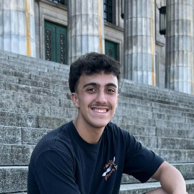
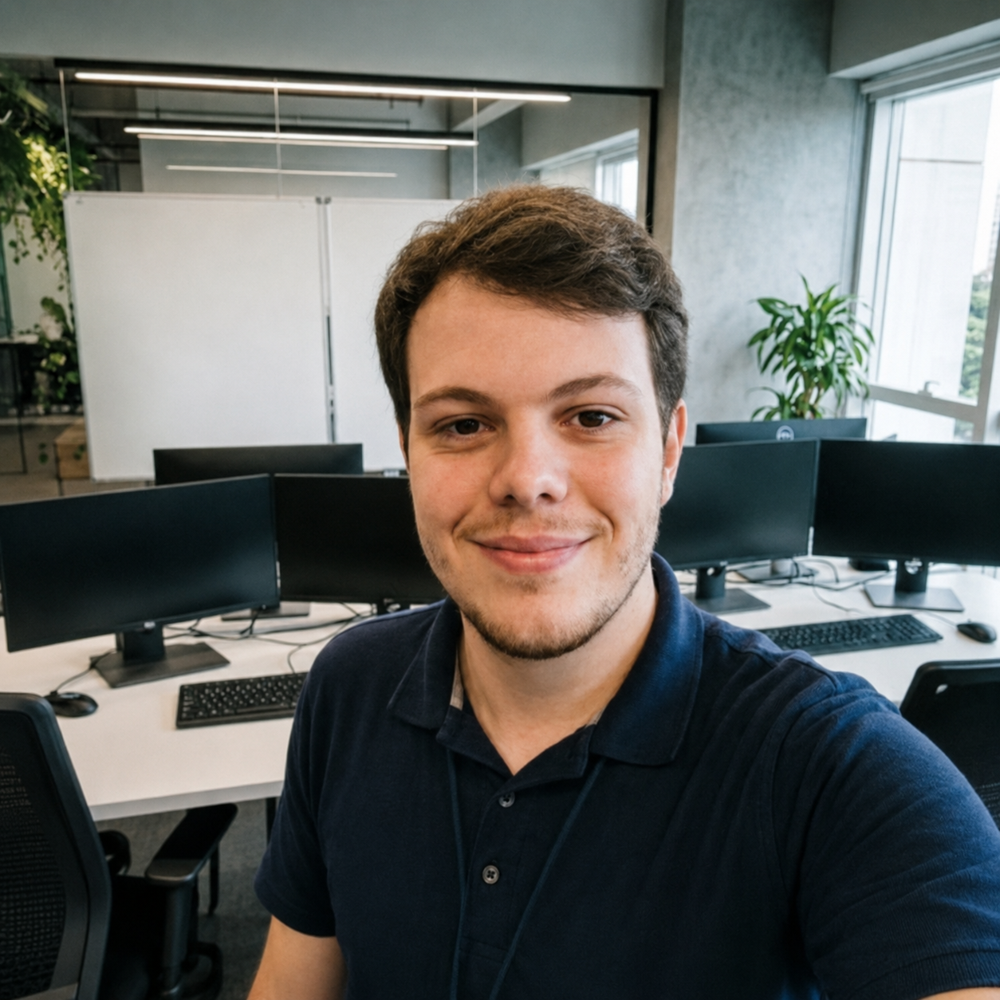
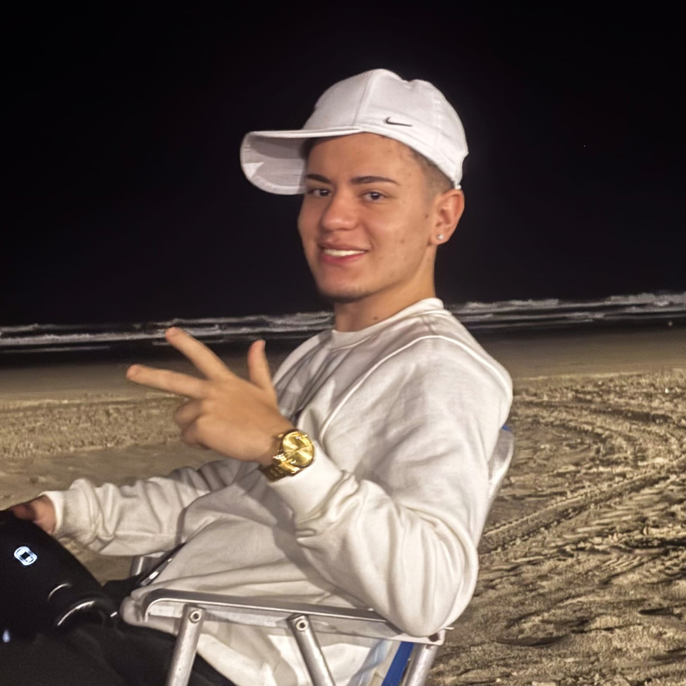

# Espelho Meu — Front-End

Projeto da turma **1TDSPW de ADS da FIAP**, Global Solution 2026/2. Interface em React, Vite, TypeScript e Tailwind CSS, com integração às APIs Java e Flask. Esta pasta contém código, lockfile, assets originais e guias de contribuição.

## Executar e validar

Use Node.js **22.12+**. Na raiz do repositório:

```bash
cd front-end
cp .env.example .env.local
npm ci
npm run dev
```

```bash
npm test
npm run typecheck
npm run build
npm run preview
```

`npm test` verifica validação de acesso e renderização das rotas/filtros via React no servidor; não substitui teste interativo em navegador. Não há script de lint configurado. O build gera `dist/`. Para Vercel, usar `front-end` como Root Directory; `vercel.json` contém o fallback das rotas da SPA.

## Fluxo autenticado

As entradas públicas são `/`, `/sobre`, `/integrantes`, `/integrantes/:id`, `/faq`, `/contato`, `/entrar` e `/cadastro`. Na landing, “Começar consultoria” abre `/entrar` e preserva `/consultoria` como destino após o login; quem já está autenticado segue diretamente para a consultoria. A conta fica em `/minha-conta`. Em `/consultoria`, escolha a jornada de cabelo ou maquiagem. Ambas têm etapas de perfil, preferências, produtos, revisão e resultado. A análise facial com foto é opcional na jornada capilar. Sobre, Integrantes, FAQ e Contato estão disponíveis sem login no menu e no rodapé. O painel `/admin` exige a role `ADMIN` e oferece os cadastros de produtos, usuários e cortes.

A simulação usa os estilos selecionados na comparação do resultado de cabelo ou maquiagem. O envio exige consentimento. Cada consulta admite até três prévias. A recuperação de senha depende de um serviço de envio de e-mails e ainda não está disponível.

O front acessa o Java no mesmo domínio pela rota `/api/java`. O proxy do Vite aponta para `127.0.0.1:8080` e o da Vercel para o serviço Java. A sessão usa cookie HttpOnly, e as requisições de escrita incluem o token obtido em `GET /auth/csrf`. O Flask recebe as chamadas de consultoria somente pelo Java. A [configuração da API Java](../java/README.md) descreve a migração e as variáveis necessárias.

Veja o [guia de ativação e teste da simulação](../java/README.md#publicar-e-medir-a-simulação).

## Organização e revisão

| Caminho | Conteúdo |
| --- | --- |
| `src/app/` | Rotas e caminhos compartilhados |
| `src/components/layout/` | Cabeçalho preservado, layout público e layout sem cabeçalho para acesso/conta |
| `src/pages/inspiracao/` | Cabelo/maquiagem, dados editoriais, filtros, diálogo e estilos |
| `src/pages/acesso/` | Formulários, validação e layout de cadastro reaproveitado no acesso |
| `src/pages/conta/` | Navegação da conta em estado não autenticado |
| `src/pages/catalogo/` | Atalhos por categoria |
| `src/pages/consultoria/` | Abertura e seleção de jornada |
| `src/assets/figma/` | Exports originais locais e registro de origem |
| `tests/` | Validação de campos e renderização de rotas |
| [codigo integrantes/](<codigo integrantes/README.md>) | Guias de Arthur, Yasmin, Matheus P. e Matheus L., com código, montagem e cinco entregas cada |

Os guias dos integrantes e o plano de commits registram a divisão original do trabalho. O rodapé faz parte do layout das páginas públicas.

## Referências e limites desta revisão

[Protótipo completo](https://www.figma.com/design/MBJ63zN0jlITf2nwYWabqb/Espelho-Meu?node-id=0-1).

[Protótipo complementar do Espelho Meu](https://www.figma.com/design/hw6Yjl2K35smRmMOwM4z7D/Untitled?node-id=0-1) · referência visual, com acesso sujeito às permissões do Figma.

Foram consultados os frames [home](https://www.figma.com/design/MBJ63zN0jlITf2nwYWabqb/Espelho-Meu?node-id=20-363), [cabelo](https://www.figma.com/design/MBJ63zN0jlITf2nwYWabqb/Espelho-Meu?node-id=54-104), [maquiagem](https://www.figma.com/design/MBJ63zN0jlITf2nwYWabqb/Espelho-Meu?node-id=74-464), [cadastro](https://www.figma.com/design/MBJ63zN0jlITf2nwYWabqb/Espelho-Meu?node-id=35-379), [conta](https://www.figma.com/design/MBJ63zN0jlITf2nwYWabqb/Espelho-Meu?node-id=150-1400) e [consultoria](https://www.figma.com/design/MBJ63zN0jlITf2nwYWabqb/Espelho-Meu?node-id=3-1739), com código e screenshots de referência.

O limite do plano Figma impediu a leitura de [catálogo](https://www.figma.com/design/MBJ63zN0jlITf2nwYWabqb/Espelho-Meu?node-id=3-1783), [login](https://www.figma.com/design/MBJ63zN0jlITf2nwYWabqb/Espelho-Meu?node-id=27-98) e [recuperação](https://www.figma.com/design/MBJ63zN0jlITf2nwYWabqb/Espelho-Meu?node-id=74-169). Essas telas receberam navegação/formulários com os componentes existentes; a fidelidade aos respectivos frames permanece pendente. O cadastro usa o layout disponível; conta e consultoria foram adaptadas para deixar explícito o estado sem autenticação.

O ZIP `espelho-meu-frontend-v2.zip` da biblioteca ChatGPT não estava acessível nesta sessão nem anexado localmente. A versão exata **não foi incorporada**; o trabalho partiu do código local e dos frames disponíveis.

## Conferência manual

1. Como visitante, abra diretamente a conta, a consultoria e o painel e confirme o redirecionamento para Entrar.
2. Sem login, abra Sobre, Integrantes, o detalhe de um integrante, FAQ e Contato pelo menu e rodapé. Clique em “Começar consultoria” e confira a tela de login. Cadastre uma conta, entre, recarregue a página e confira a sessão.
3. Complete as jornadas de cabelo e maquiagem. Em cabelo, compare as opções com e sem coloração e penteados. Para análise facial, use uma foto autorizada.
4. Como usuário comum, tente abrir o painel. Como administrador, teste criar, listar, editar e excluir um registro em cada entidade usando dados fictícios.
5. Confira o layout em 390, 768 e 1440 px e navegue usando Tab, Shift+Tab e Enter.

## Avaliação e entrega

| Item | Link ou status |
| --- | --- |
| GitHub | [Monorepo Espelho Meu](https://github.com/Dev-Ulrich/espelho-meu) |
| Vercel | [Site publicado](https://espelho-meu-two.vercel.app/) |
| API Java | [Saúde da API](https://espelho-meu-java.onrender.com/saude) |
| Vídeo no YouTube | Pendente de publicação |
| Contato do grupo | [Issues do projeto](https://github.com/Dev-Ulrich/espelho-meu/issues) |

O ZIP do Portal deve ter até 50 MB. Inclua código, configurações, recursos, README e identificação do grupo; exclua `node_modules`, `.git` e `dist`. Os assets originais são grandes: conferir o tamanho do ZIP final. Cada integrante registra suas próprias cinco contribuições, após revisão, com pelo menos quinze commits no total conforme os critérios da disciplina.

[Voltar ao índice](../README.md)

## Etapa 1 — landing pública e conferência de telas (19/11/2026)

Conferência dos itens “Páginas e responsividade” e “Componentização e rotas” da seção Front-End Design Engineering do documento **1TDS Fevereiro - Global Solution 2026-2.pdf**. Esta tabela verifica a existência e o acesso às telas; não certifica toda a entrega acadêmica nem a integração remota.

| Requisito | Implementação / situação |
| --- | --- |
| Home | `/`: apresentação, como funciona, benefícios, dúvidas expansíveis e chamada para login |
| Sobre | `/sobre`: pública |
| Integrantes | `/integrantes`: pública, com fotos, nomes, RMs, turma, funções e perfis profissionais |
| FAQ | `/faq`: pública, perguntas expansíveis e orientações de foto |
| Contato | `/contato`: pública, link para issues do projeto; não há formulário de envio |
| Pelo menos duas páginas da solução | Jornadas distintas em `/consultoria/cabelo/:etapa` e `/consultoria/maquiagem/:etapa`; exigem sessão |
| Rota com parâmetro | `/integrantes/:id`, além das etapas da consultoria |
| Mobile, tablet e desktop | CSS adaptativo existente; inspeção visual em 390 × 844, 768 × 1024 e 1440 × 900 pendente nesta etapa |

Referências de organização consultadas: [Prepila Dyson](https://github.com/Dev-Ulrich/PrepilaDysonFrontEndRepository) e [EcoVolt](https://github.com/Dev-Ulrich/EcoVoltRepositoryFE). Servem de base para navegação pública, apresentação da equipe e documentação; seus vídeos, dados de demonstração e imagens de telas não representam o Espelho Meu.

Pendências identificadas para próximas etapas:

- Acrescentar capturas reais e atualizadas do Espelho Meu ao README.
- Publicar e registrar o vídeo do projeto no YouTube; os links de GitHub, Vercel, API e contato já estão na tabela de entrega acima, mas sua operação remota não foi revalidada nesta etapa.
- Validar visualmente a landing e os fluxos em navegador. Não havia navegador conectado para essa conferência nesta sessão.
- Comparar com os frames atuais do Figma: a consulta do primeiro arquivo foi bloqueada por permissão; a do segundo atingiu o limite do plano. Foram preservados os assets e a identidade visual já presentes no checkout, sem declarar equivalência visual aos protótipos.

Validação desta etapa: `npm test` e `npm run build` (inclui TypeScript). A cobertura de rotas verifica conteúdo institucional público, links da home para login e preservação da proteção das áreas internas.

Apoio de IA nesta etapa: Codex para leitura dos requisitos e referências, ajuste da navegação/landing, FAQ expansível e atualização dos testes de renderização. Pedido de referência: “landingpage inicial pública ... redirecionada para o login”. A revisão humana do grupo, os registros completos de prompts e a demonstração da integração continuam sob responsabilidade da equipe.

## Equipe

Dados e funções fornecidos pelo grupo; fotos importadas do [repositório indicado](https://github.com/Dev-Ulrich/PrepilaDysonFrontEndRepository/tree/main/assets/images/avatares) e servidas localmente.

| Foto | Integrante | RM | Turma | Função | Perfis |
| --- | --- | --- | --- | --- | --- |
|  | Victor Ulrich Costa Alves da Silva | 568634 | 1TDSPW | Desenvolvimento (Front-end e Chatbot), banco de dados e documentação. | [GitHub](https://github.com/Dev-Ulrich) · [LinkedIn](https://www.linkedin.com/in/victorulrichcosta/) |
|  | Matheus Pereira da Silva Franco | 569315 | 1TDSPW | Desenvolvimento (Java e Front-end), banco de dados e documentação. | [GitHub](https://github.com/MatheusPSFranco) · [LinkedIn](https://www.linkedin.com/in/matheus-pereira-da-silva-franco-b7a7b03b7/) |
|  | Matheus Luca Fouad Barragão | 572228 | 1TDSPW | Desenvolvimento (Python e Front-end) e documentação. | [GitHub](https://github.com/MatheusLuca) · [LinkedIn](https://www.linkedin.com/in/matheusbarragao/) |
|  | Arthur da Silva Santana | 571075 | 1TDSPW | Desenvolvimento (Front-end), edição e roteirização. | [GitHub](https://github.com/arthursantana1521) · [LinkedIn](https://www.linkedin.com/in/arthur-da-silva-santana-a6061a310) |
|  | Yasmin Capi | 571926 | 1TDSPW | Desenvolvimento (Front-end), prototipação, edição e roteirização. | [GitHub](https://github.com/yasmincappi) · [LinkedIn](https://www.linkedin.com/in/yasmincappi/) |

### Foto na hora

Na pergunta de formato do rosto da consultoria capilar, selecione a análise por foto e use **Tirar foto agora**. A mesma opção está disponível na simulação dos resultados de cabelo e maquiagem. Permita o acesso à câmera, confira a prévia e clique em **Capturar foto**. É possível tirar outra foto, remover a selecionada ou escolher um arquivo. A câmera é encerrada ao capturar, cancelar ou sair da etapa; a captura permanece local até a confirmação do envio no fluxo existente.

A câmera requer HTTPS (ou localhost) e permissão do navegador. Sem câmera ou com permissão negada, a escolha de arquivo continua disponível. Capturas são JPEG; fotos aceitas: JPG, PNG ou WebP, até 5 MB. Verificação com câmera física e permissões no celular/desktop ainda pendente; testes automatizados e build não substituem essa conferência.
